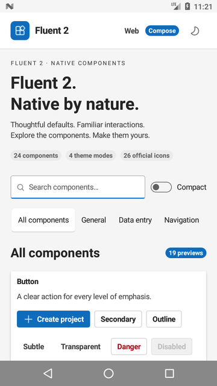
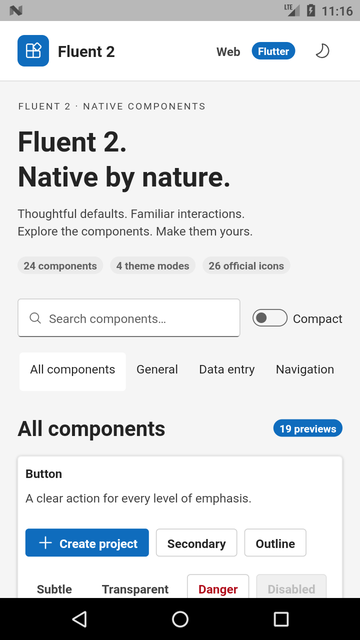

# Fluent 2 Native

**24 core Fluent 2 component families for Compose Multiplatform/KMP and Flutter**, with matching interactive catalogs. Native rendering, official Microsoft theme tokens and system icon paths, with no React runtime or WebView in the native apps.

This is an independent **0.1.0 community port**, not a Microsoft product or a complete replacement for Fluent UI React. The [coverage matrix](docs/coverage.md) describes the supported APIs and remaining work. The separate [Ant Design Native repository](https://github.com/fajarxfce/ant-design-native) is not a dependency.

| Compose Multiplatform | Flutter |
| --- | --- |
|  |  |

## Included

- 120 official color tokens and 69 numeric tokens, generated into both languages.
- Four real Microsoft themes: Web light/dark and Teams light/dark. Compact density independently changes the default control size.
- 26 official Fluent System Icons, rendered from vector paths.
- Button, Typography, Icon, Input, Field, Textarea, Checkbox, Radio, Switch, Dropdown, TabList, Card, Badge, CounterBadge, Avatar, Divider, MessageBar, ProgressBar, Spinner, Skeleton, Dialog, Accordion, Breadcrumb, and Link.
- Controlled selection, native text editing, async confirmation, keyboard navigation, focus indicators, touch targets, RTL-aware layouts, and reduced-motion settings.
- Android catalogs with distinct application IDs; Compose desktop/Wasm and Flutter web entry points.

## Run the catalogs

Requirements: JDK 17+, Android SDK 36, Flutter 3.47.5/Dart 3.13.4. Node 22 and Python 3 are needed only to regenerate/check upstream assets. GNU Make provides the optional command shortcuts.

```bash
# Compose desktop
./gradlew :compose-catalog:run

# Compose Android
./gradlew :compose-catalog:assembleDebug

# Flutter Android, desktop, or web: choose an available device
cd examples/flutter
flutter pub get
flutter run
```

Android packages are `dev.fluent2.catalog.compose` and `dev.fluent2.catalog.flutter`. These can coexist with the Ant catalogs. Installation over ADB:

```bash
adb -s YOUR_DEVICE install -r examples/compose/build/outputs/apk/debug/compose-catalog-debug.apk

cd examples/flutter
flutter build apk --release --split-per-abi --target-platform android-arm64,android-x64
adb -s YOUR_DEVICE install -r build/app/outputs/flutter-apk/app-arm64-v8a-release.apk
```

The sample apps use development signing, including the optimized Flutter demo APK. Supply your own signing configuration for store distribution. No keys, local SDK paths, or device addresses are committed.

## Use the libraries

Include `packages/compose` as a Gradle subproject and depend on `project(":fluent-compose")` from `commonMain`. For Flutter, use a local `path` dependency on `packages/flutter` (`fluent2_flutter`). These packages are not published to Maven Central or pub.dev yet.

```kotlin
import dev.fluent2.core.*

FluentTheme(tokens = FluentTokens.teamsDark) {
    FluentButton(onClick = { save() }, type = FluentButtonType.Primary) {
        FluentText("Save changes")
    }
}
```

```dart
import 'package:fluent2_flutter/fluent2_flutter.dart';

FluentTheme(
  data: const FluentThemeData(tokens: FluentTokens.teamsDark),
  child: FluentButton(
    type: FluentButtonType.primary,
    onPressed: save,
    child: const FluentText('Save changes'),
  ),
)
```

Public tokens preserve Microsoft names such as `colorBrandBackground`, `colorNeutralForeground1`, and `fontSizeBase300`. Compose overrides use `tokens.copy(colors = tokens.colors.copy(colorBrandBackground = color))`; Flutter exposes `tokens.copyWith(colorBrandBackground: color)`. Override related hover/pressed/foreground tokens together when creating a custom brand.

## Source and validation

The export tool pins `@fluentui/react-components` **9.74.9**, `@fluentui/react-theme` **9.2.2**, and `@fluentui/react-icons` **2.0.344**. The native libraries consume generated sources checked into Git. [Architecture](docs/architecture.md) explains the theme pipeline and platform choices.

```bash
npm ci --prefix tools/tokens --ignore-scripts
make check-tokens
make test-compose test-flutter analyze
make apk-compose apk-flutter
./gradlew :compose-catalog:wasmJsBrowserDistribution
cd examples/flutter && flutter build web
```

Without Make, run `npm --prefix tools/tokens run check`, both Python generators with `--check`, `./gradlew :fluent-compose:desktopTest` (under `xvfb-run -a` on headless Linux), and `flutter test` / `flutter analyze` in each Flutter package. [Verification](docs/verification.md) records tested platforms and device checks. GitHub Actions builds the Android/browser artifacts and uploads test reports.

## Scope and licensing

This first version focuses on the core components above. DataGrid, Tree, DatePicker, Combobox, Menu, Toolbar, Toast, and complete Fluent React variant/API parity remain future work. iOS, macOS, and Windows require validation on their respective hosts. System font fallback is used; proprietary Segoe fonts are not bundled. Browser builds do not establish browser interaction parity.

[MIT](LICENSE). Microsoft theme/icon notices and the attribution for the native interaction foundation are retained in [THIRD_PARTY_NOTICES.md](THIRD_PARTY_NOTICES.md). Design guidance: [fluent2.microsoft.design](https://fluent2.microsoft.design/).
